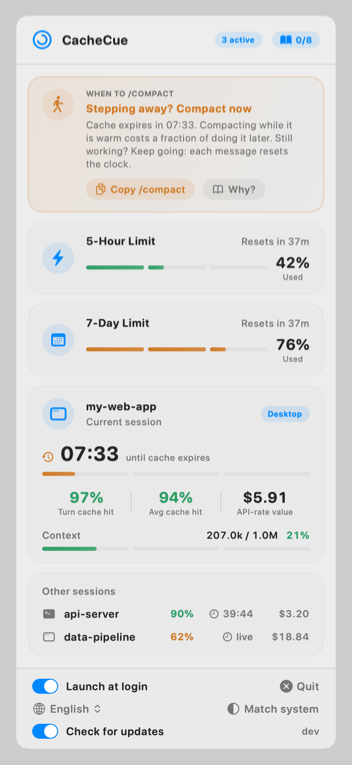
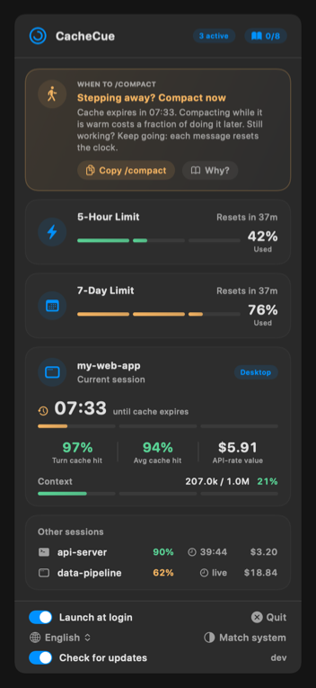
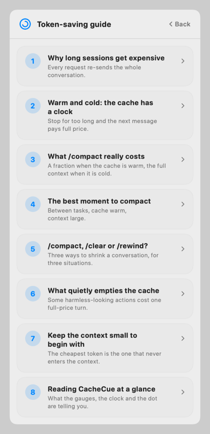
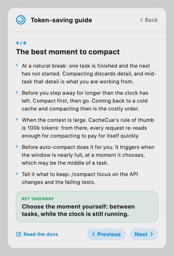

# CacheCue

**Know when to `/compact`.** A macOS menu bar app for [Claude Code](https://code.claude.com) that watches your prompt cache, your context size and your rate limits, and tells you whether now is a good moment to compact, and why.

<p>
  
  
</p>

In the menu bar it is two small gauges and a countdown:


- **5h / 7d**: how much of each rate-limit window is used
- **the clock**: time left before the current session's prompt cache expires (`live` while a turn is running, `exp` once it has expired)
- **the dot**: CacheCue has something for you to act on

CacheCue is not affiliated with Anthropic.

## Why the timing of `/compact` matters

Claude Code re-sends your whole conversation with every request. Prompt caching makes that cheap, as long as the cache is warm. That makes the moment you compact worth choosing:

- **While the cache is warm**, the request that writes the summary reads your history from the cache, so compacting costs a fraction of what the context size suggests.
- **After the cache has expired**, the same request reprocesses the full history uncached. That is the most expensive moment to compact, and your next message would have reprocessed it all anyway.
- **Compacting throws detail away**, so the middle of a task is the worst place for it, and on a small context it costs more than it saves.
- **`/clear` costs nothing.** For unrelated work it beats compacting.

Cache reads are billed at a tenth of the base input price or less, and one-hour cache writes at twice the base price, so letting a large context go cold costs at least 20 times what keeping it warm does. The cache lives for an hour on a Claude subscription, and five minutes on usage credits, an API key or a cloud provider.

Sources: [How Claude Code uses prompt caching](https://code.claude.com/docs/en/prompt-caching), [Manage costs effectively](https://code.claude.com/docs/en/costs), [Prompt caching pricing](https://platform.claude.com/docs/en/build-with-claude/prompt-caching).

## What CacheCue advises

For the session that last did something, the first rule that applies:

| Situation | Advice |
| --- | --- |
| A turn is running | Nothing: wait for it to end |
| Context window 80% full or more | Compact now, before auto-compact picks its own moment |
| Context under 50k tokens | No need: compacting would cost more than it saves |
| Cache expired | Decide before you continue: `/clear` if you are done with the history, otherwise `/compact` first |
| Cache expires within 10 minutes | Stepping away? Compact now. Still working? Keep going, each message resets the clock |
| Context of 100k tokens or more | Compact at the next stopping point, between tasks |
| Otherwise (50k to 100k) | Compact only when switching tasks |

The thresholds are rules of thumb, not figures from Anthropic. The advice card has a button that copies `/compact` for you to paste, and a **Why?** that opens the lesson behind the advice.

## A short course in spending fewer tokens

The book button in the popover opens an eight-lesson guide, each a few points and one takeaway, with a link to the documentation it is drawn from:

<p>
  
  
</p>

1. Why long sessions get expensive
2. Warm and cold: the cache has a clock
3. What `/compact` really costs
4. The best moment to compact
5. `/compact`, `/clear` or `/rewind`?
6. What quietly empties the cache
7. Keep the context small to begin with
8. Reading CacheCue at a glance

The lessons are written in English, 简体中文 and 繁體中文; in the other languages they read in English.

## Install

Requires macOS 13 or later.

1. Download [CacheCue.dmg](https://github.com/MinLi999/CacheCue/releases/latest/download/CacheCue.dmg) (or pick a version from [Releases](https://github.com/MinLi999/CacheCue/releases)) and drag CacheCue to Applications. It is signed and notarized, and runs on Apple silicon and Intel.
2. Open it. It lives in the menu bar and has no Dock icon.
3. Click the menu bar item, then **Set up** on the "Terminal status line is not set up" card.

Step 3 points Claude Code's `statusLine` setting at CacheCue's own command. It keeps every other setting, and saves a copy of the file first as `~/.claude/settings.json.cachecue-backup`. If you already have a status line, CacheCue asks before replacing it. From a terminal the same thing is:

```bash
/Applications/CacheCue.app/Contents/MacOS/CacheCue setup-statusline
```

Restart your terminal sessions and each one gets a status line, which is also what feeds the menu bar:

```text
cache 94% avg 96% ◷47:36 | 5h ▰▱▱▱▱▱▱▱ 2% ↻4h36m | 7d ▰▰▰▰▰▰▱▱ 76% ↻13h56m | ↑68.6k ↓9.6k ◆1.0M | $206.51 | ⇲ compact at next break
```

From left to right: this request's cache hit rate, the session's, time until the cache expires; the 5-hour and 7-day limits with their reset countdowns; context tokens, last output tokens and the window size; the session's cost; and the cue to compact, when there is one.

### Claude desktop app (optional)

The desktop app does not run status line commands. To get the same band above the prompt there, and to have desktop sessions show up in the menu bar, install the plugin from a terminal session:

```text
/plugin install cachecue --marketplace MinLi999/CacheCue
```

The plugin is built on Claude Code's function-hooks API, which is in early access and may change between releases without notice. In the desktop app it only sees a turn's totals when the turn ends, so there its hit rate is per turn, not per request, and its countdown assumes the one-hour cache.

## What it reads, and what it does not

- **One network request, which you can turn off.** Once a day CacheCue asks GitHub for this repository's latest release, to tell you when there is an update. It sends nothing about you or your sessions. The switch is at the bottom of the popover. Nothing else touches the network.
- **No credentials.** It never reads your Claude login, Keychain items or cookies.
- **No transcripts.** It does not read your conversations.

Everything it shows is what Claude Code hands to a status line command or a plugin: token counts, rate-limit percentages, the cache expiry time and the session's cost. Each session's figures are kept as one small JSON file in `~/Library/Caches/CacheCue/`, which the menu bar app reads; files untouched for a week are removed.

## Good to know

- **Rate limits** appear only on Claude Pro and Max plans, after a session's first response.
- **The cache countdown** in the terminal needs Claude Code 2.1.251 or later.
- **Several sessions at once:** the limits are your account's, and CacheCue shows the most recently received reading. The cache, context and advice shown are those of the session that last did something; the rest are listed underneath. Click one to keep it in view, and **Follow latest** to let go.
- **The dollar figure** is Claude Code's own estimate at API list prices. On a Pro or Max subscription your usage is included in the plan, so it is not what you are billed: CacheCue labels it "API-rate value" there, and "Session cost" only when there is no subscription.
- **Updates:** when a newer release is out, a card at the top of the popover says so and opens the download. The version you are running is at the bottom.
- **Languages:** English, 简体中文, 繁體中文, 日本語, 한국어, Deutsch, Français, Español, Português, Italiano, Nederlands, Svenska, Polski, Русский, Türkçe, Bahasa Indonesia, Tiếng Việt, ไทย, हिन्दी and العربية, switchable from the popover along with light and dark appearance. The translations have not been reviewed by native speakers; corrections are welcome.

## Build from source

Needs Xcode's command line tools. No dependencies.

```bash
cd app
swift test
./build-app.sh --install
```

`build-app.sh --install` builds `CacheCue.app`, signs it ad hoc and copies it to `~/Applications`. `build-app.sh --release` makes a universal, notarized DMG with your own Developer ID, taking the next version number by itself; `release.sh` does that and publishes it as a GitHub release.

The plugin has its own checks:

```bash
claude plugin validate plugin
claude plugin test plugin
```

## How it fits together

```text
terminal session ── statusLine ──▶ CacheCue statusline ─┐
                                                        ├─▶ ~/Library/Caches/CacheCue/<session>.json ──▶ menu bar app
desktop session ─── cachecue plugin ────────────────────┘
```

- `app/Sources/CacheCueCore`: everything that decides what is shown (the advice rules, the guide, the status line, snapshots, the update check, the 20 languages), with no UI code, and the tests that cover it.
- `app/Sources/CacheCue`: the SwiftUI popover, the menu bar item and the command-line entry points.
- `plugin/`: the band for the desktop app.

## License

MIT
